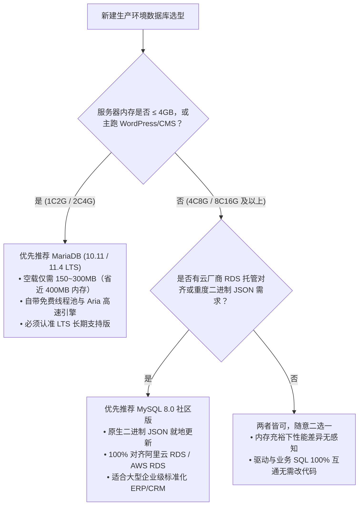

# QILNMP

<div align="center">

**现代化、高性能、轻量级 Linux LNMP 自动化部署与运维套件**

专注于现代生产环境 · 锁定双安全基线 (PHP 8.4 / 8.5) · 零后台常驻进程 · 100% 纯离线构建

[](https://github.com/wujiit/qilnmp/releases)
[](https://www.php.net)
[](https://nginx.org)
[](https://www.mysql.com)
[](https://mariadb.org)
[](https://github.com/wujiit/qilnmp/blob/master/LICENSE)

[官方网站](https://qiling.jingxialai.com/qilnmp) · [官方软件源导航](https://qiling.jingxialai.com/qilnmp/docs/sources.html) · [提交反馈 / Issue](https://github.com/wujiit/qilnmp/issues)

</div>

---

## 目录

- [项目说明与分支信息](#项目说明与分支信息)
- [对比原版 OneinStack 的调整与精简](#对比原版-oneinstack-的调整与精简)
- [服务器硬件智能感知与动态调优](#服务器硬件智能感知与动态调优)
- [数据库选型指南：MySQL 8.0 vs MariaDB LTS](#数据库选型指南mysql-80-vs-mariadb-lts)
- [操作系统支持与技术断代说明](#操作系统支持与技术断代说明)
- [快速安装部署](#快速安装部署)
- [纯离线构建与私有镜像源支持](#纯离线构建与私有镜像源支持)
- [命令行静默自动化安装参数](#命令行静默自动化安装参数)
- [全功能运维脚本工具箱](#全功能运维脚本工具箱)
  - [vhost.sh 虚拟主机与 SSL 管理](#vhostsh-虚拟主机与-ssl-管理)
  - [wordpress.sh 一键建站](#wordpresssh-一键极速建站)
  - [security.sh 防 CC 与安全防护](#securitysh-基础安全与防-cc-模块)
  - [upgrade.sh 平滑原地热升级](#upgradesh-平滑原地热升级)
  - [uninstall.sh 精细化组件卸载](#uninstallsh-精细化组件卸载)
  - [backup.sh 与云对象存储备份](#backupsh-自动化全量备份)
  - [reset_db_root_password.sh 密码重置](#reset_db_root_passwordsh-数据库密码重置)
  - [tools 目录实用体检工具](#tools-目录实用工具)
- [默认目录与服务管理速查](#默认目录与服务管理速查)
- [常见问题与排错 (FAQ)](#常见问题与排错-faq)
- [交流社群与联系方式](#交流社群与联系方式)
- [English Summary](#english-summary)

---

## 项目说明与分支信息

- **上游原始作者**：yeho `<lj2007331 AT gmail.com>`
- **上游原始仓库**：[oneinstack/oneinstack](https://github.com/oneinstack/oneinstack)
- **分支维护者**：summer `<iticu@qq.com>`
- **官方网站**：[https://qiling.jingxialai.com/qilnmp](https://qiling.jingxialai.com/qilnmp)
- **代码仓库**：[https://github.com/wujiit/qilnmp](https://github.com/wujiit/qilnmp)
- **开源许可证**：[Apache-2.0](https://github.com/wujiit/qilnmp/blob/master/LICENSE)

---

## 对比原版 OneinStack 的调整与精简

QILNMP 是基于 OneinStack 进行精简与现代版本适配的维护分支，主要做了以下服务减法与针对性新增强化：

### 1. 移除与精简的服务
- **移除 Apache (httpd) 与 LAMP 栈**：不再提供 Apache 编译与运行配置，Web 服务专注于高性能 Nginx 架构（支持 Nginx、Tengine、OpenResty、Caddy）；
- **移除 Tomcat 与 Java/JDK 运行时**：剔除 Tomcat 7/8/9/10 及 Adoptium/OpenJDK 等 Java 运行环境，大幅精简脚本体积与复杂度；
- **清退 PHP 8.4 以下所有已停服旧版本**：全面移除了 PHP 5.3 ~ 8.3 全系版本（避免历史高危漏洞与 php2shell 严重 RCE 风险），当前仅支持并锁定修补后的 `PHP 8.4.27` 与 `PHP 8.5.12`；
- **清理已淘汰的陈旧扩展**：删除了 ZendGuardLoader、eAccelerator、mcrypt 等古董扩展与陈旧补丁。

### 2. 新增与强化的专属服务
- **新增 `wordpress.sh` 一键极速建站服务**：针对主流 WordPress 与 WooCommerce 跨境电商量身定制，自动化完成站点目录构建、自动建库、生成高强度 `wp-config.php`、配置专属 Nginx 伪静态与 Opcache 深度调优，支持 Let's Encrypt 证书自动申领与商业 SSL 证书一键导入；
- **新增 `security.sh` 专属安全防护与防 CC 模块**：专为 Nginx 架构设计单 IP 限频（15r/s，突发 30）保护，并联动 Fail2ban 自动监控访问日志（`/data/wwwlogs/*nginx.log`），实时将频繁恶意扫描与高频 CC 攻击 IP 送入系统防火墙自动封禁；
- **新增硬件智能感知与动态调优（`memory.sh`）**：在 1C2G、2C4G 等轻量服务器上自动检测并创建 3GB Swap，防止编译 MySQL / OpenSSL 时因内存耗尽被 Linux OOM 杀进程，并动态自适应分配 PHP-FPM 工作进程树、OPcache 与 MySQL 缓冲池大小；
- **纯离线部署就地编译**：只要将所需源码压缩包放入本地 `src/` 目录，安装脚本会自动识别并跳过网络下载，完全不产生外部网络请求；
- **核心组件基线现代化升级**：Nginx 升级至 1.30.6，底层编译链升级至 OpenSSL 3.5.9 LTS，数据库支持 MySQL 8.0/9.0 及 MariaDB 10.11/11.4 LTS。

---

## 服务器硬件智能感知与动态调优

脚本在启动时会自动读取物理/虚拟硬件配置，并依据真实硬件规格实施动态调优策略（详见 `include/memory.sh`）：

### 1. 自动化 Swap 智能兜底（针对轻量服务器）
若系统未划分 Swap 交换分区，脚本将自动在根目录下创建 **3GB 优化型虚拟内存文件（`/swapfile`）** 并挂载开机自启。彻底规避在 1核2G 或 2核4G 服务器上因多并发编译 OpenSSL 3.5 或 MySQL 时触发 Linux OOM Killer 杀掉编译进程的情况。

### 2. 硬件梯度配置自适应表

| 硬件规格 | Swap 策略 | PHP `memory_limit` | OPcache 内存 | PHP-FPM 工作进程配置 (`pm`) | MySQL `innodb_buffer_pool` |
|---|---|---|---|---|---|
| **1核 2G 内存** | 自动创建 3GB | `128M` | `64M` | `max: 20` / `start: 10` / `min: 10` / `max_spare: 20` | `256M` |
| **2核 4G 内存** | 自动创建 3GB | `320M` | `128M` | `max: 50` / `start: 30` / `min: 20` / `max_spare: 40` | `1024M (1G)` |
| **4核 8G 内存** | 按需创建 4GB | `512M` | `256M` | `max: 100` / `start: 50` / `min: 30` / `max_spare: 80` | `2048M (2G)` |
| **8核 16G 内存** | 系统默认或 4GB | `1024M` | `512M` | `max: 200` / `start: 100` / `min: 50` / `max_spare: 150` | `4096M (4G)` |

> [!TIP]
> 2核4G 服务器在优化后，MySQL 独享 1GB 缓冲池，留足约 2.5GB 物理内存与 3GB 虚拟交换空间供 PHP-FPM 50 个工作并发平稳承接高负载，杜绝内存耗尽假死。

---

## 数据库选型指南：MySQL 8.0 vs MariaDB LTS

两者底层语法、数据类型与客户端协议 100% 兼容平替，但在系统资源开销与特定高级特性上各有侧重：



### 生产选型三大黄金法则：
1. **轻量级服务器（1核2G / 2核4G）及经典 CMS 建站首选 MariaDB**：常驻空载仅需 150~300MB（比 MySQL 8.0 节省近 400MB+），自带免费线程池优化，省下的内存可充分布置给 PHP-FPM 与 Redis；
2. **重度依赖二进制 JSON 或对齐云厂商托管选 MySQL 8.0**：MySQL 8.0 的原生二进制 JSON 嵌套查询与局部就地更新性能优异；
3. **生产环境选 MariaDB 必须严格认准 LTS（长期支持版）**：强烈推荐官方维护至 2028 年的 `MariaDB 10.11 LTS` 或维护至 2029 年的 `11.4 LTS`。**切勿追随滚动尝鲜版（如 short-lived 创新版）**。

---

## 操作系统支持与技术断代说明

### ✅ 官方正式支持的 64 位操作系统：
- **RHEL 系列**：Rocky Linux `8.x / 9.x`、AlmaLinux `8.x / 9.x`、RHEL `8.x / 9.x`、CentOS Stream `8 / 9`、Oracle Linux `8 / 9`、Anolis OS `8+`、OpenCloudOS `8+`、openEuler `22+`
- **Debian 系列**：Debian `11 (Bullseye)`、Debian `12 (Bookworm)`、Debian `13 (Trixie)`
- **Ubuntu 系列**：Ubuntu `20.04 LTS`、`22.04 LTS`、`24.04 LTS` 及更高版本
- **CPU 架构**：`x86_64` (amd64) 与 `aarch64` (arm64)

### ❌ 明确不支持并由安装脚本强制拦截的旧系统：
- **CentOS 7.x（含 CentOS 7.9 及所有早期 7.x/6.x 分支）**
- **Debian 10 及更早版本（Debian 10/9/8）**
- **Ubuntu 18.04 / 16.04 及更早版本**
- **所有 32 位操作系统**

> [!CAUTION]
> **为什么必须彻底封禁并拒绝支持 CentOS 7.9？**
> 1. **官方生命周期彻底终结（EOL）：** CentOS 7 已于 2024 年 6 月 30 日停服，官方 Yum 源全线失效，内核累积不可修复高危漏洞；
> 2. **编译器版本严重断代（GCC 4.8.5）：** 现代 PHP 8.4/8.5 核心强依赖 C11 标准与现代 C++17 特性（要求 GCC ≥ 8.1），旧编译器在语法解析阶段即直接崩溃报错；
> 3. **底层 C 运行库断代（glibc 2.17）：** 现代通用的 MySQL 8.0 社区二进制包、OpenSSL 3.5、jemalloc 均依赖 `glibc ≥ 2.28`，在 glibc 2.17 上会直接触发 `GLIBC_2.28 not found` 致命段错误；
> 4. **底层基础加密库脱节：** CentOS 7 自带 OpenSSL 1.0.2 与 cURL 7.29，无法满足现代 TLS 1.3、HTTP/2/3 及 Argon2 / Sodium 加密算法的硬性基线。

---

## 快速安装部署

### 1. RHEL / Rocky / AlmaLinux (8/9+)

```bash
# 1. 安装基础依赖与 screen
yum -y install wget screen git || dnf -y install wget screen git

# 2. 克隆项目仓库并进入目录
git clone https://github.com/wujiit/qilnmp.git
cd qilnmp

# 3. 开启 screen 会话防止网络断线中断编译
screen -S qilnmp
chmod +x *.sh
./install.sh
```

### 2. Debian 11/12 & Ubuntu 20/22/24

```bash
# 1. 更新源并安装基础依赖
apt-get update && apt-get -y install wget screen git

# 2. 克隆项目仓库并进入目录
git clone https://github.com/wujiit/qilnmp.git
cd qilnmp

# 3. 开启 screen 会话防止网络断线中断编译
screen -S qilnmp
chmod +x *.sh
./install.sh
```

### 💡 安装首步交互提示：MD5 校验选择说明

运行 `./install.sh` 时，终端第一道提问为：
```text
Do you want to check md5sum? [y/n]:
```
* **什么时候选 `n`（直接按回车跳过）**：
  * **通过 `git clone` 获取的代码仓库**：因为本地直接就是源码目录，并没有预先打包的 `qilnmp.tar.gz` 压缩文件，此时**必须选择 `n`**（如果选 y 会因找不到 `.tar.gz` 提示文件不存在并退出）；
  * **离线内网部署或自建环境**：无需进行远程哈希对比，直接选 `n` 进入下一步安装。
* **什么时候选 `y`**：
  * **下载官方发布的 `qilnmp.tar.gz` 离线压缩包安装**：推荐输入 `y`。脚本将自动比对安装包哈希与官方源 `md5sum.txt`，确保传输过程没有丢包损坏或被劫持。

> [!TIP]
> 如果编译过程中因网络问题导致 SSH 连接断开，无需惊慌，重新连上服务器后执行 `screen -r qilnmp` 即可无缝切回原安装进度界面。

---

## 纯离线构建与私有镜像源支持

### 1. 极速纯离线构建（本地 `src/` 方式）
无需服务器连接公网。在外网电脑下载好组件包并放入 `qilnmp/src/` 目录，打包拷贝至服务器直接解压运行 `./install.sh`，脚本检测到本地文件存在将直接原地校验解压编译：

```bash
# 外网机器打包
tar czvf qilnmp-offline.tar.gz qilnmp/

# 拷贝到目标内网机器后直接运行
tar xzf qilnmp-offline.tar.gz
cd qilnmp
chmod +x *.sh
./install.sh
```

*各组件官方纯净源码直链与标准归档命名规范详见：* **[docs/sources.html](https://qiling.jingxialai.com/qilnmp/docs/sources.html)**

### 2. 自建私有局域网镜像源（团队多机推荐）
团队内部若管理多台服务器，强烈推荐使用开源镜像系统 **[MirrorOne (dalao-org/MirrorOne)](https://github.com/dalao-org/MirrorOne)** 在内网或专网搭建专属镜像站。在 `options.conf` 中配置主镜像直链：

```bash
mirror_link=https://mirror.yourdomain.com
mirror_fallback_links='https://mirror-backup.yourdomain.com'
```

---

## 命令行静默自动化安装参数

适合运维编写 Ansible、云初始化脚本（Cloud-init）或批量无交互无人值守部署：

```bash
./install.sh \
  --nginx_option 1 \
  --php_option 2 \
  --phpcache_option 1 \
  --php_extensions "imagick redis memcached fileinfo" \
  --db_option 1 \
  --dbinstallmethod 1 \
  --dbrootpwd 'Your_Strong_Password_123' \
  --redis \
  --phpmyadmin \
  --md5sum
```

### 参数选项速查对照表：

| 参数 | 取值范围 | 说明 |
|---|---|---|
| `--nginx_option` | `1~4` | `1`: Nginx, `2`: Tengine, `3`: OpenResty, `4`: Caddy |
| `--php_option` | `1~2` | **`1`: PHP 8.4.27**，**`2`: PHP 8.5.12**（双安全基线，杜绝高危旧版） |
| `--phpcache_option` | `1~2` | `1`: OPcache（强烈推荐），`2`: APCu |
| `--php_extensions` | 字符串 | 常用扩展：`imagick`, `redis`, `memcached`, `fileinfo`, `swoole`, `mongodb`, `xdebug` |
| `--db_option` | `1~16` | **`1`: MySQL 8.0**, **`5`: MariaDB 10.11 LTS**, **`16`: MariaDB 11.4 LTS**, `15`: MySQL 9.0 |
| `--dbinstallmethod` | `1~2` | `1`: 官方通用免编译二进制极速安装（推荐），`2`: 源码编译安装 |
| `--dbrootpwd` | 字符串 | 指定数据库 root 初始密码 |
| `--redis` | 标志开关 | 一并安装 Redis 服务端并配置 systemd 自启 |
| `--phpmyadmin` | 标志开关 | 一并安装 phpMyAdmin Web 端图形管理工具 |
| `--mphp_ver` | `84` / `85` | 安装第二个共存 PHP 版本（多版本共存部署） |

---

## 全功能运维脚本工具箱

### `vhost.sh` 虚拟主机与 SSL 管理

```bash
# 1. 交互式创建虚拟主机（引导式配置域名、目录、伪静态、SSL）
./vhost.sh

# 2. 命令行快速创建并自动申领 Let's Encrypt 免费 SSL
./vhost.sh --add --domain example.com --ssl letsencrypt --letsencrypt-email admin@example.com

# 3. 指定使用第二版本 PHP（如多版本共存场景下的 PHP 8.5）
./vhost.sh --add --domain api.example.com --mphp_ver 85

# 4. 列出当前已配置的所有虚拟主机站点
./vhost.sh --list

# 5. 删除指定站点（支持同步安全删除站点配置文件与日志）
./vhost.sh --del
```

---

### `wordpress.sh` 一键极速建站

针对 WordPress 与 WooCommerce 量身打造，全自动完成站点目录构建、自动建库、生成高强度 `wp-config.php`、配置专属 Nginx 伪静态与 Opcache 调优：

```bash
# 极速一键部署（自动创建独立数据库并配置 Let's Encrypt SSL）
./wordpress.sh \
  --domain blog.example.com \
  --ssl letsencrypt \
  --letsencrypt-email admin@example.com

# 使用现有数据库，导入自定义商业证书
./wordpress.sh \
  --domain shop.example.com \
  --ssl own \
  --ssl-crt /etc/ssl/shop.crt \
  --ssl-key /etc/ssl/shop.key \
  --db-create n \
  --db-name existing_db \
  --db-user existing_user \
  --db-pass 'YourPassword_123'
```

---

### `security.sh` 基础安全与防 CC 模块

针对 Nginx 栈提供单 IP 限频（15r/s，突发 30）保护，并联动 Fail2ban 实时分析 `/data/wwwlogs/*nginx.log`，对恶意扫描与高频 CC 攻击 IP 实施系统防火墙自动封禁：

```bash
./security.sh --install     # 安装并部署防 CC 模块与 Fail2ban 规则
./security.sh --status      # 查看当前防护运行状态与已封禁的攻击 IP 清单
./security.sh --disable     # 临时停用限频防护（保留配置文件）
./security.sh --enable      # 重新启用防护
./security.sh --uninstall   # 彻底卸载防护规则
```

---

### `upgrade.sh` 平滑原地热升级

用于在同系列分支内平滑升级补丁版本（如 PHP 8.5.x 升级至 8.5.12、Nginx 升级至 1.30.6）。自动继承历史编译参数，网站配置与模块完全不丢失：

```bash
./upgrade.sh --php 8.5.12    # 原地升级 PHP 到指定补丁版本
./upgrade.sh --nginx 1.30.6  # 原地升级 Nginx 版本
./upgrade.sh --redis 7.2.7   # 升级 Redis 服务端
./upgrade.sh --db 8.0.44     # 升级数据库补丁版本
```

> [!NOTE]
> 跨 Zend API 的大版本切换（例如 PHP 8.4 升级到 8.5），请使用 `./install.sh --mphp_ver 85` 进行多版本灰度验证，确认主题和插件完全兼容后再行切换。

---

### `uninstall.sh` 精细化组件卸载

支持针对单一受损组件进行局部精准卸载清理，无需推倒整台服务器：

```bash
./uninstall.sh --php                   # 仅卸载默认 PHP（主 PHP）
./uninstall.sh --mphp_ver 84           # 仅卸载指定的副版本 PHP 8.4
./uninstall.sh --php_extensions redis  # 仅从 PHP 中移除 redis 扩展模块
./uninstall.sh --mysql                 # 仅卸载 MySQL/MariaDB 数据库
./uninstall.sh --web                   # 仅卸载 Nginx Web 服务
./uninstall.sh --all                   # 彻底清理所有 LNMP 组件与运行目录
```

---

### `backup.sh` 自动化全量备份

支持本地归档、远程 FTP 备份，以及直传阿里云 OSS、腾讯云 COS、七牛云、又拍云、AWS S3 等对象存储服务：

```bash
# 1. 运行交互式向导配置云存储凭证与备份策略
./backup_setup.sh

# 2. 执行一次即时全量备份（备份网站数据文件与数据库 SQL）
./backup.sh

# 3. 配置 Linux Crontab 定时任务（例如每日凌晨 02:00 自动执行并上云）
0 2 * * * cd /root/qilnmp && ./backup.sh > /dev/null 2>&1
```

---

### `reset_db_root_password.sh` 数据库密码重置

在忘记或遗失数据库超级管理员 root 密码时使用：

```bash
# 交互式输入新密码重置
./reset_db_root_password.sh

# 命令行非交互强制重置为指定密码
./reset_db_root_password.sh --force --password 'MyNewStrongPass_2026'
```

---

### `tools/` 目录实用工具

```bash
# 1. 完整运行环境体检（输出 Nginx/PHP/DB 版本、FPM 状态、已加载扩展树）
bash tools/stack_status.sh

# 2. 单一指定数据库极速转储
(cd tools && bash db_bk.sh your_database_name)

# 3. 单一指定虚拟主机站点文件快速打包
(cd tools && bash website_bk.sh your_site_domain)
```

---

## 默认目录与服务管理速查

### 1. 核心安装与数据目录

| 组件 | 安装主目录 | 核心配置文件 | 访问日志 / 错误日志路径 | 数据持久化路径 |
|---|---|---|---|---|
| **Nginx** | `/usr/local/nginx` | `/usr/local/nginx/conf/nginx.conf` | `/data/wwwlogs/*nginx.log` | `/data/wwwroot` |
| **PHP** | `/usr/local/php` | `/usr/local/php/etc/php.ini` | `/usr/local/php/var/log/php-fpm.log` | `/usr/local/php/etc/php-fpm.d/` |
| **MySQL** | `/usr/local/mysql` | `/etc/my.cnf` | `/data/mysql/*.err` | `/data/mysql` |
| **MariaDB** | `/usr/local/mariadb`| `/etc/my.cnf` | `/data/mariadb/*.err` | `/data/mariadb` |
| **Redis** | `/usr/local/redis` | `/usr/local/redis/etc/redis.conf` | `/usr/local/redis/var/redis.log` | `/usr/local/redis/var/dump.rdb`|

### 2. 系统服务常用控制命令

```bash
# Nginx 管理
systemctl {start|stop|restart|reload|status} nginx
/usr/local/nginx/sbin/nginx -t # 语法检测

# PHP-FPM 管理
systemctl {start|stop|restart|reload|status} php-fpm
/usr/local/php/sbin/php-fpm -t # 语法检测

# MySQL / MariaDB 管理
systemctl {start|stop|restart|status} mysqld

# Redis 管理
systemctl {start|stop|restart|status} redis-server
/usr/local/redis/bin/redis-cli ping # 连通性测试 (返回 PONG)

# 端口监听排查
ss -lntp | grep -E ':80|:443|:3306|:6379|:9000'
```

---

## 常见问题与排错 (FAQ)

### Q1：离线部署时，MySQL 官方安装包需要提前放入 `src/` 吗？
> **答：** MySQL 8.0 官方二进制免编译安装包体积约 850MB，为保持 GitHub 代码仓库极致轻量，该包不预置在仓库中。
> - 若服务器可访问公网：安装脚本在执行到数据库步骤时会自动从官方直链高速下载；
> - 若服务器纯内网完全断网：建议在外网电脑从 [官方源导航](https://qiling.jingxialai.com/qilnmp/docs/sources.html) 下载 `mysql-8.0.44-linux-glibc2.28-x86_64.tar.xz`，提前放入 `qilnmp/src/` 目录中即可。

### Q2：跨大版本升级 PHP（如 8.4 升级到 8.5）可以直接用 `upgrade.sh` 吗？
> **答：不能。** 跨大版本的 Zend API 内部数据结构存在重大破坏性变更，强行原地替换会导致旧扩展（如 imagick、redis）发生段错误崩溃。
> 推荐方案：
> 1. 执行 `./install.sh --mphp_ver 85` 部署共存版本 PHP 8.5；
> 2. 使用 `./vhost.sh` 平滑切换测试站点无误后，再使用 `./uninstall.sh --mphp_ver 84` 清理旧版本。

### Q3：为什么 PHP 8.4 与 8.5 共用一套底层安装逻辑？
> **答：** 这是专为现代安全基线设计的模块化重构（`include/php-modern-common.sh`）。PHP 8.4 与 8.5 共享相同的现代 C11 构建标准、依赖库版本与安全加固参数，统一逻辑既能确保构建质量高度一致，也天然免疫历史上所有的已知核心 RCE 漏洞。

### Q4：执行 install.sh 时提示 “Do you want to check md5sum? [y/n]”，应该选 y 还是 n？
> **答：**
> - **通过 `git clone` 获取的代码：请输入 `n` 跳过**（代码已由 Git 自身的 SHA 哈希链保障完整性，且本地没有 `qilnmp.tar.gz` 压缩包，输 y 会报错退出）；
> - **下载 `qilnmp.tar.gz` 离线压缩包：可输入 `y` 校验**（验证下载包是否完整未被篡改）。脚本目前已支持智能检测本地包是否存在并给出默认推荐值，直接按回车即可。

---

## 交流社群与联系方式

欢迎加入 QQ 交流群，与众多一线运维和站长共同交流 LNMP 架构调优与 PHP 8.4/8.5 实践经验：

- **WordPress 站长技术交流群**：`16966111`
- **WooCommerce 跨境电商交流群**：`580246438`
- **灵简 AI 研发交流群**：`591117073`
- **启灵软件支持群**：`200766709`
- **技术支持与商务联系邮箱**：`iticu@qq.com`

---

## English Summary

**QILNMP** is a streamlined, lightweight Linux LNMP automated deployment and maintenance suite forked from OneinStack.

- **Streamlined Stack**: Removed Apache (LAMP) and Java (Tomcat/JDK) runtime components, focusing purely on high-performance Nginx;
- **Dual Security Baselines**: Strictly locked to **PHP 8.4.27** and **PHP 8.5.12**, eliminating all legacy EOL PHP versions and known core vulnerabilities;
- **Lightweight & Clean**: Shell-native automation with zero background daemon processes;
- **Hardware-Aware Auto-Tuning**: Dynamically adapts Swap, PHP-FPM worker pools, OPcache, and MySQL InnoDB buffer pool size according to system resources (e.g. 2C4G, 4C8G, 8C16G);
- **Production Database Advisory**: Clear selection metrics between MariaDB LTS (optimized for ≤4GB RAM & CMS) and MySQL 8.0 (native binary JSON & cloud RDS alignment);
- **100% Offline & Private Mirror Ready**: Bypasses all outbound network requests if packages are pre-placed in `src/`, fully compatible with [MirrorOne](https://github.com/dalao-org/MirrorOne);
- **Modern OS Support**: Exclusively supports enterprise 64-bit Linux distributions (RHEL/Rocky/AlmaLinux 8/9, Debian 11/12/13, Ubuntu 20/22/24 LTS); strictly blocks obsolete EOL systems such as CentOS 7.
